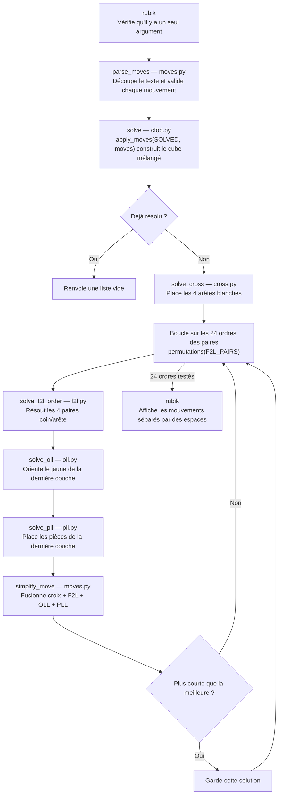
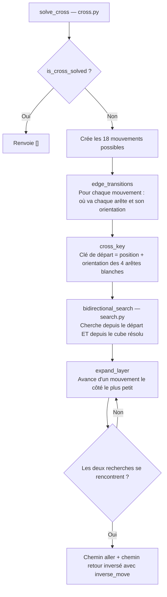
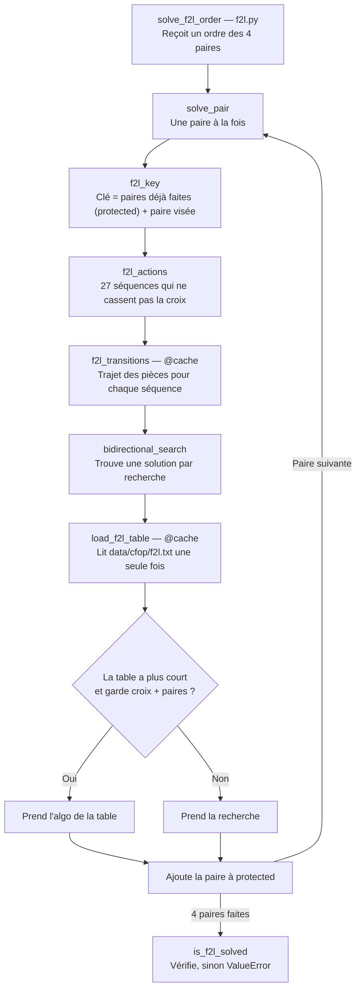
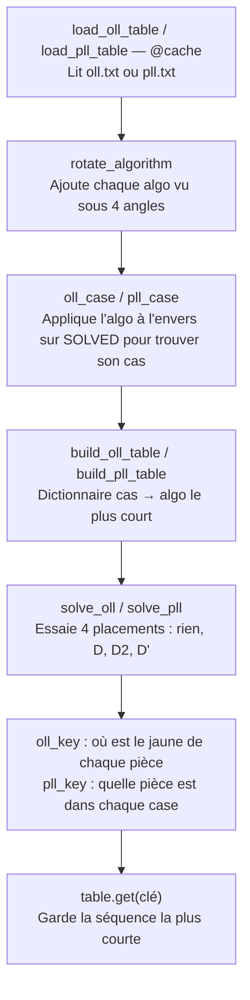

# Chemin des commandes

Tous les mélanges suivent le même parcours

```bash
./rubik "R U F' D2"
```

## Le cube en mémoire

- Un cube = une liste de 20 tuples (une case par pièce)
- Cases 0 à 11 = les 12 arêtes (tuples de 2 couleurs)
- Cases 12 à 19 = les 8 coins (tuples de 3 couleurs)
- `Positions` (cube.py) donne un nom à chaque case : `Positions.UF` = 0, `Positions.URF` = 12
- `SOLVED` (cube.py) = le cube résolu, sert de modèle pour toutes les comparaisons
- L'ordre des couleurs dans un tuple suit les faces du nom de la case (`POSITION_FACE`)
- Croix blanche sur U, dernière couche jaune sur D

## Vue d'ensemble

- Croix (fondation) → F2L (2 étages) → OLL (couleur du dernier étage) → PLL (rangement du dernier étage)



## Croix — `solve_cross`

- Le but : un « plus » blanc sur la face du haut, et la 2e couleur de chaque arête sous le bon centre
- Le programme ne regarde que les 4 arêtes blanches : où elles sont et de quel côté est leur blanc
- Il essaie les 18 mouvements depuis le cube mélangé, puis 18 depuis chaque résultat, et ainsi de suite
- En même temps, il fait pareil en partant d'un cube résolu
- Dès que les deux côtés tombent sur la même position, il recolle : chemin depuis le mélange + chemin vers le résolu joué à l'envers
- Comme il avance coup par coup, la première rencontre donne une croix très courte



## F2L — `solve_f2l_order`

- Le but : finir les 2 premières couches sous la croix, donc remplir les 4 coins blancs et les 4 arêtes du milieu
- On les range par paires : un coin + l'arête juste en dessous = une paire, il y a 4 emplacements
- Il range une paire à la fois
- Il n'utilise que des gestes qui gardent la croix : tourner la couche du bas, ou ouvrir un côté (`R`), tourner le bas, refermer (`R'`)
- Il cherche la plus courte suite de gestes qui place la paire et remet les paires déjà faites (même recherche que la croix)
- Il regarde aussi la liste d'algos connus `f2l.txt` et prend l'algo s'il est plus court
- L'ordre des paires change la solution, donc il essaie les 24 ordres possibles



## OLL et PLL — `solve_oll` puis `solve_pll`

OLL
- Le but : il ne reste que la couche jaune, on veut toute la face jaune jaune, même si les pièces ne sont pas à leur place
- Le programme regarde de quel côté pointe le jaune sur les 8 pièces : ce dessin = le « cas »
- Au départ, il joue chaque algo de `oll.txt` à l'envers sur un cube résolu pour voir quel cas il résout
- Il range tout ça dans un dictionnaire : cas → algo le plus court
- Il tourne la face jaune 4 fois (rien, `D`, `D2`, `D'`) pour reconnaître le cas sous tous les angles

PLL
- Le but : la face jaune est faite, mais les côtés de la dernière couche sont mélangés, il faut échanger les pièces pour les remettre à leur place
- Le cas = quelle pièce est dans quelle case
- Même méthode que l'OLL, avec la liste `pll.txt`
- Si besoin, un dernier tour du bas (`D`, `D2` ou `D'`) aligne la couche → cube fini



- Une table est construite une seule fois grâce à `@cache`, puis réutilisée pour les 24 ordres
- La PLL teste aussi 4 finitions (`D`, `D2`, `D'`) pour aligner la dernière couche

## Erreurs

- Pas exactement un argument → `Usage : ./rubik "<melange>"`, code 1
- Mouvement inconnu → `Erreur : mouv invalide : X`, code 1
- Problème pendant la résolution → `Erreur de resolution : ...`, code 2
